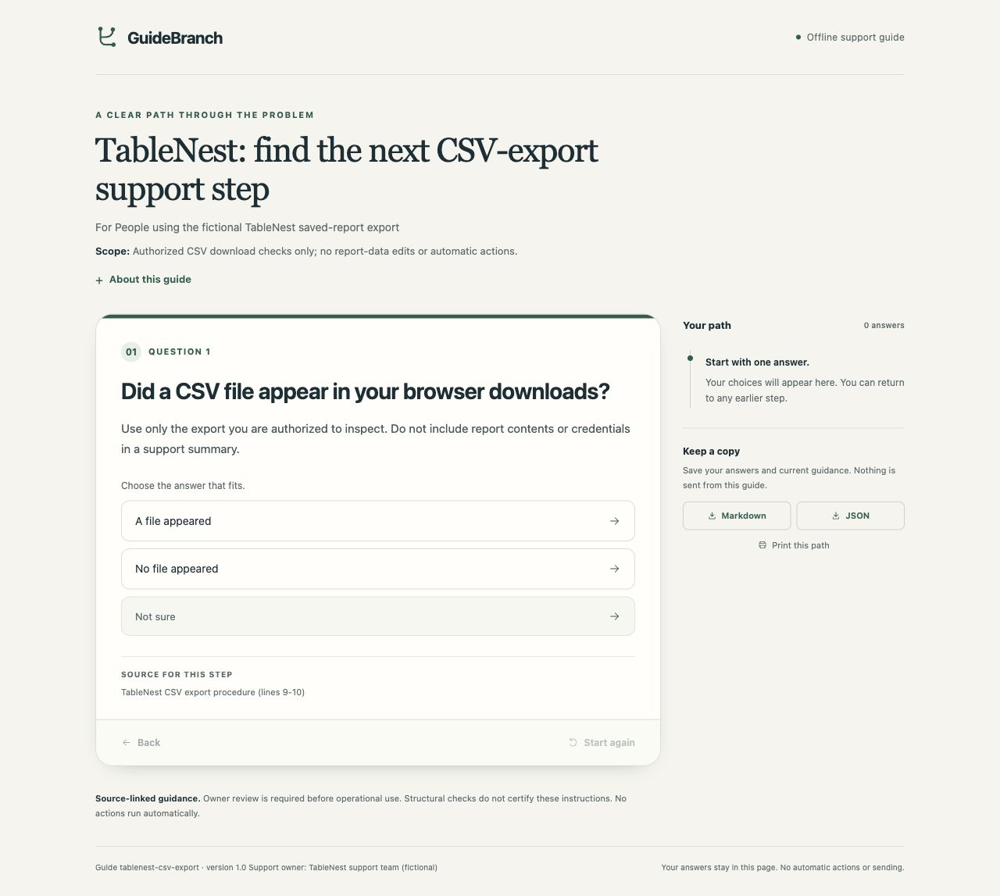

# GuideBranch: a support guide people can follow

This free worked example shows the output of **GuideBranch — Support SOPs to Interactive Guides**. TableNest and its support procedure are fictional. No customer files or paid builder source are included.

GuideBranch is awaiting Agensi review. This example is available now; it is not a claim that the skill has been approved or is available to purchase.

See [Israel Diego's Agensi profile](https://www.agensi.io/creators/israel-diego) for currently available skills.



## Inspect the finished result

- [guide.html](guide.html): the complete interactive reader, including its styles and JavaScript.
- [SOP.md](SOP.md): the fictional instructions used for this example.
- [Mobile screenshot](mobile.jpg) and [file hashes and qualification scope](manifest.json).

GitHub's code view does not run HTML. Download `guide.html` and open it in an authorized HTML/browser preview. JavaScript is required. The recorded browser checks used HTTP localhost. With Python 3 available, you can serve a directory containing only this fictional example:

```sh
python3 -m http.server 8000 --bind 127.0.0.1
```

Then open `http://127.0.0.1:8000/guide.html` in your browser. Stop the temporary server when finished.

## Try these two paths

1. Choose **A file appeared**, then **Yes, it opens**, then **The headings match**. The guide reaches **Review the downloaded rows**. That next step does not certify the data or establish that an issue is resolved.
2. Start again and choose **Not sure**. The guide directs the reader to **Ask the support owner**, instead of guessing a remedy.

Use **Back** or edit an earlier answer in the trail. Later answers are cleared. The Markdown and JSON download buttons save the current answer path locally; nothing is sent to a support team automatically. Reloading clears the session.

## What the separate skill adds

Give your Agensi-connected agent approved software-support instructions and the intended audience. GuideBranch helps the agent author a new guide, check its exact source citations and structure, and return the HTML with separate author-review files. The skill needs Python 3.10+, authorized file/shell tools and a browser preview. It has no separately metered processing API or API key.

Source approval and faithful interpretation still require editorial review. Structural checks do not certify policy correctness. The reader contains every authored branch and has no access control. Hosting, sharing and source privacy are separate decisions.

This example is for ordinary software support. It is not a medical, legal, financial, emergency or safety-critical decision guide.
